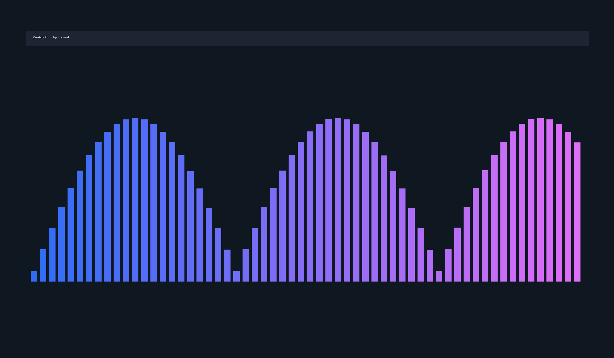

# Search Latency Review {layout=title}

A short read on where the 2.4 second median came from and what we changed.

Note: Fifteen minutes, then questions. Skip slide 4 if the room is technical.

---

# Where the time actually went {layout=split}



The median request spent most of its life waiting rather than computing.

- Embedding call to the hosted model, **1.3 seconds**
- Vector search across 4.2 million chunks, 0.6 seconds
- Reranking the top 50 results, 0.4 seconds

Note: The embedding call is the whole story. Everything else is noise by comparison.

---

## Three numbers worth remembering

| Stage | Before | After |
| --- | --- | --- |
| Embedding | 1.3 s | 0.2 s |
| Vector search | 0.6 s | 0.5 s |
| Rerank | 0.4 s | 0.4 s |

We cached embeddings for the 900 most common queries, which covers 61 percent of traffic.

---

# What the fix looks like

```python
async def embed(query: str) -> list[float]:
    cached = await cache.get(normalise(query))
    if cached is not None:
        return cached
    vector = await client.embed(query)
    await cache.set(normalise(query), vector, ttl=86_400)
    return vector
```

Twenty lines, one Redis instance, no change to the ranking behaviour.

---

# The part I got wrong {layout=split-left}


> We assumed the vector index was the bottleneck because that is the interesting part of the system.
> - Post-mortem note

Six weeks went into index tuning that bought us 0.1 seconds.

Note: Say this one plainly. The point of the review is that we profiled too late.

---

# Watch it happen


Left side is production last month. Right side is the same query today.

---

# What we do next

1. Move the cache in front of the reranker as well
2. Profile before optimising, in writing, as a checklist item
3. Publish the latency budget so the number is somebody's job


Note: Ask for a volunteer to own the latency budget before the meeting ends.
